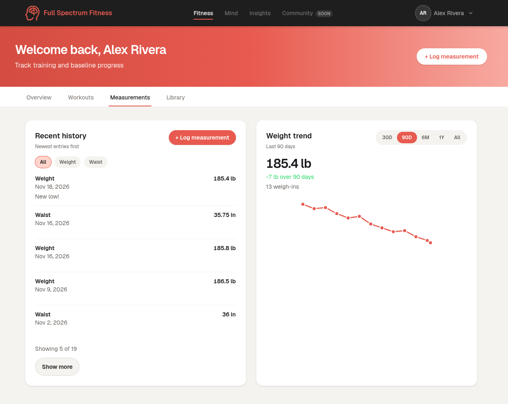
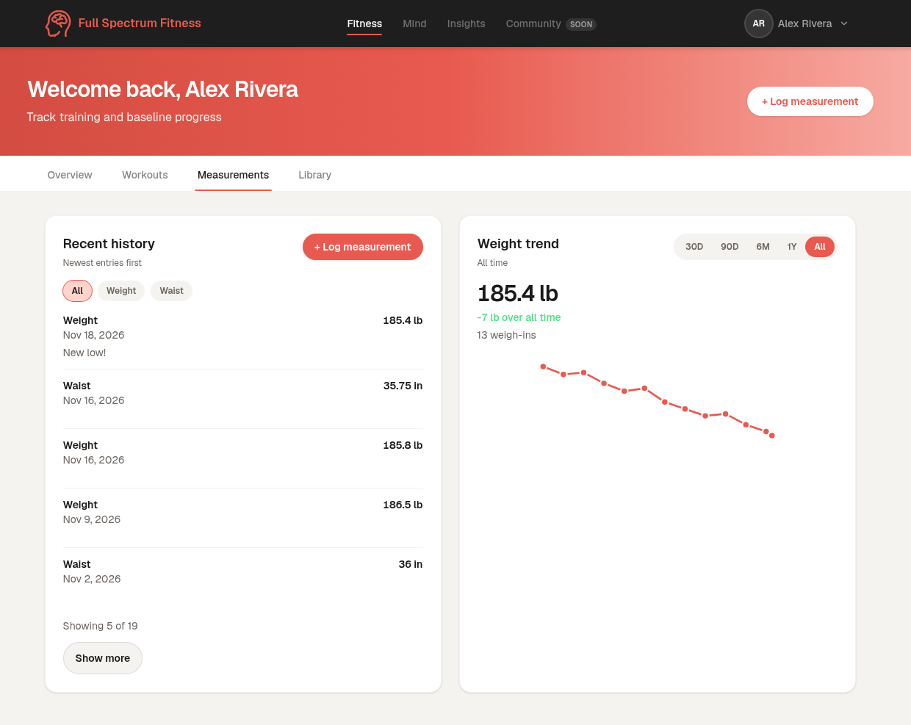
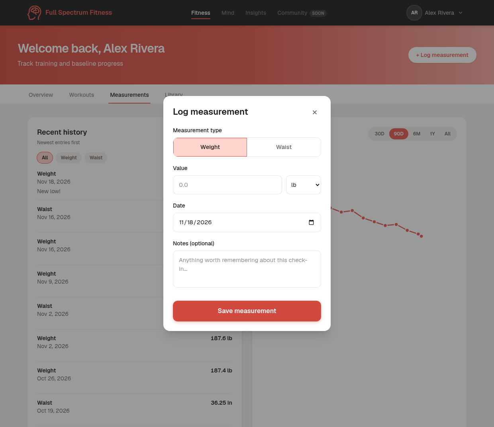
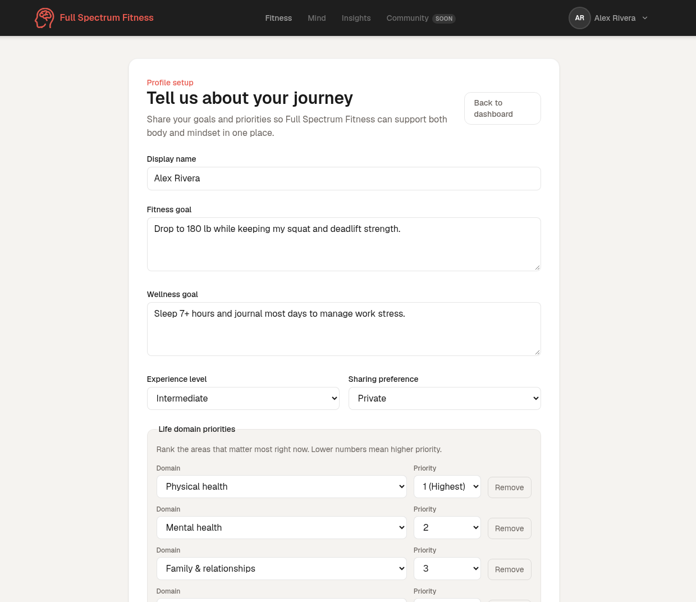
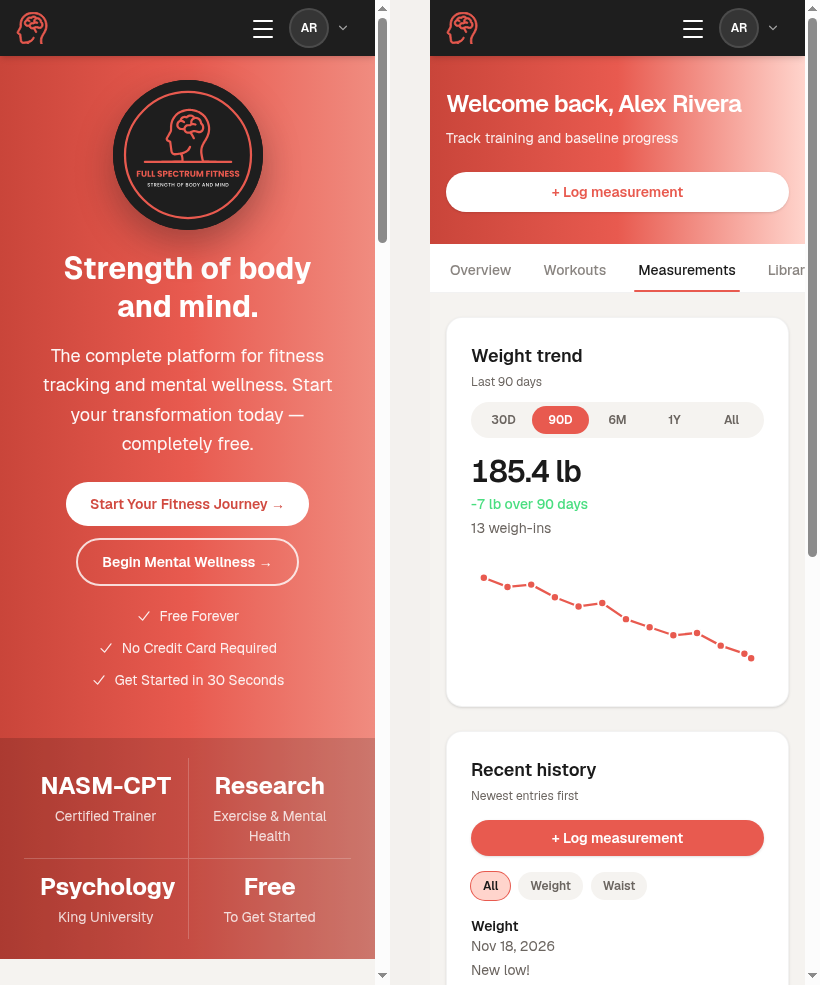
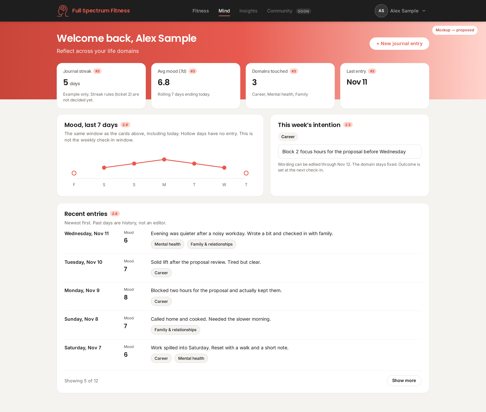
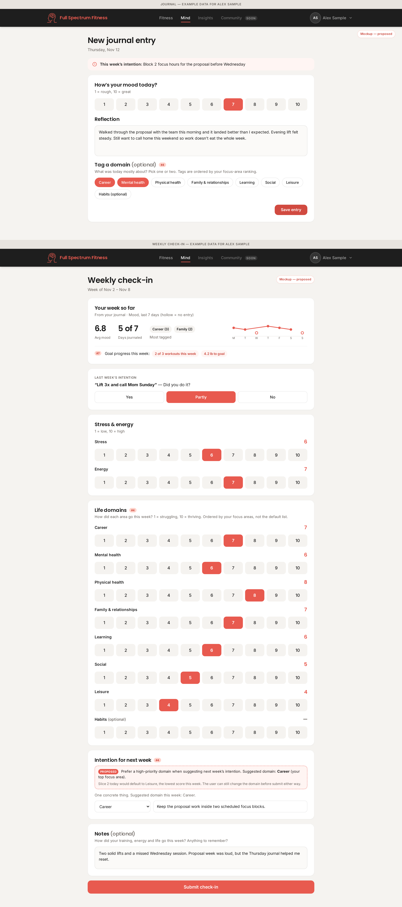
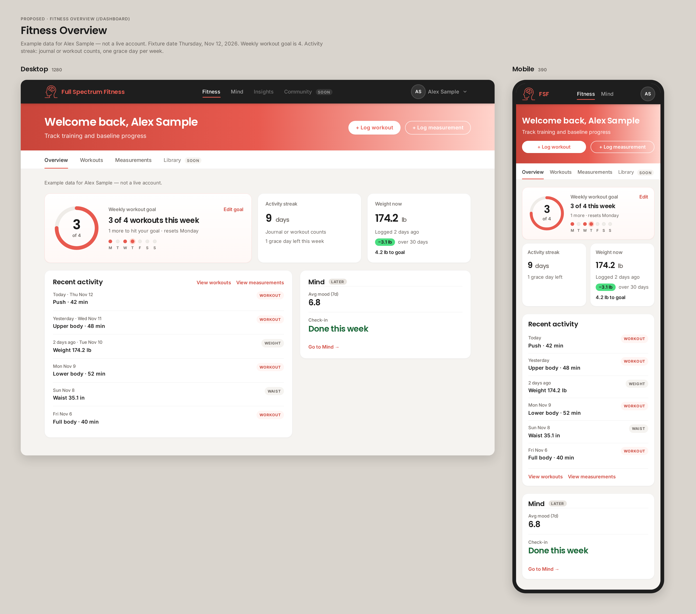
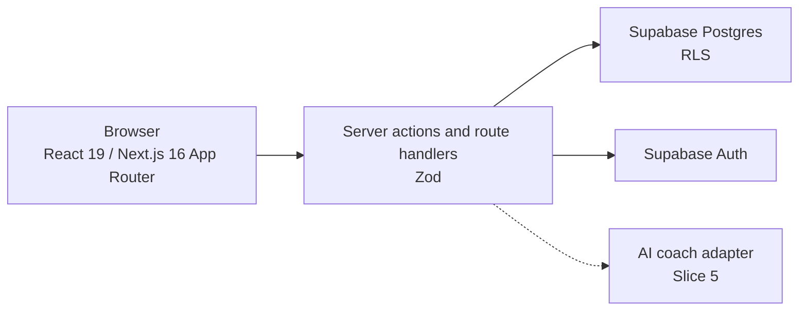

# Full Spectrum Fitness

**Track your mind. Train your body.**

Full Spectrum Fitness is a fitness and wellbeing tracker that connects training, body metrics, and mood over time.

[Live demo](https://full-spectrum-fitness-liard.vercel.app) · [Docs](docs/README.md)

[](https://github.com/Rhardin378/Full-Spectrum-Fitness/actions/workflows/ci.yml)




Live app, demo account Alex Rivera. Sample data.

## What works today

Shipped in the live demo. Status matches [Slice 1 and Slice 1.5](docs/LAUNCH_PLAN.md) in the launch plan.

- **Auth.** Supabase email sign-up and sign-in. When sign-up returns no session, the form asks the user to confirm their email. Password reset sends a link and lands on an update-password form. [`src/components/auth/auth-form.tsx`](src/components/auth/auth-form.tsx), [`src/app/auth/callback/route.ts`](src/app/auth/callback/route.ts), [`src/components/auth/update-password-form.tsx`](src/components/auth/update-password-form.tsx).
- **Profile.** Display name, fitness goal, wellness goal, experience level, sharing preference, and ranked life-domain priorities. [`src/lib/profile/actions.ts`](src/lib/profile/actions.ts).
- **Measurements.** Log, edit, and delete weight (`lb` or `kg`) and waist (`in` or `cm`). History filters by type (all, weight, waist). `listMeasurements` is cursor-paginated; the panel loads the first page of 25 and reveals more of that page with Show more. [`src/components/measurements/measurements-tab-panel.tsx`](src/components/measurements/measurements-tab-panel.tsx), [`src/lib/measurements/actions.ts`](src/lib/measurements/actions.ts).
- **Weight trend.** Chart ranges are 30D, 90D, 6M, 1Y, and All. The default is 90D. [`src/lib/measurements/trend-range.ts`](src/lib/measurements/trend-range.ts).

Measurements is the live Fitness tab. Overview, Workouts, and Library open a coming-soon panel. Mind, Insights, and Community in the header are muted; Community carries a Soon badge.

<table>
  <tr>
    <td width="50%">
      
      <br /><sub>Weight trend, All range</sub>
    </td>
    <td width="50%">
      
      <br /><sub>Log measurement</sub>
    </td>
  </tr>
  <tr>
    <td width="50%">
      
      <br /><sub>Profile</sub>
    </td>
    <td width="50%">
      
      <br /><sub>Home and dashboard at 390px</sub>
    </td>
  </tr>
</table>

## Coming soon (Slice 2+)

Designs, from [`docs/mockups/nov_2026_tickets/`](docs/mockups/nov_2026_tickets/). These screens are not in the app.

<table>
  <tr>
    <td width="33%">
      
      <br /><sub>Mind home (design)</sub>
    </td>
    <td width="33%">
      
      <br /><sub>Journal and check-in (design)</sub>
    </td>
    <td width="34%">
      
      <br /><sub>Fitness overview (design)</sub>
    </td>
  </tr>
</table>

- **Daily journal.** Mood and a reflection, plus optional one-line fields “One win today” and “Grateful for.”
- **Weekly check-in.** Stress, energy, life-domain scores, and one intention for the week.
- **Fitness overview.** Weekly workout goal, activity streak, current weight, and recent activity. It stays off until the workouts slice exists.

Order and the out-of-scope list: [`docs/LAUNCH_PLAN.md`](docs/LAUNCH_PLAN.md).

## Engineering highlights

- **Row-level security** on the user tables. `profiles` and `measurements` policies use `auth.uid() = user_id` in [`supabase/migrations/20260612003147_create_profiles_table.sql`](supabase/migrations/20260612003147_create_profiles_table.sql) and [`supabase/migrations/20260923050324_create_measurements_table.sql`](supabase/migrations/20260923050324_create_measurements_table.sql).
- **Server actions and strict Zod.** Measurement create, update, list, and delete schemas end in `.strict()` in [`src/lib/measurements/validation.ts`](src/lib/measurements/validation.ts). [`src/lib/measurements/actions.ts`](src/lib/measurements/actions.ts) writes `user_id` from `supabase.auth.getUser()`. Profile updates do the same in [`src/lib/profile/validation.ts`](src/lib/profile/validation.ts) and [`src/lib/profile/actions.ts`](src/lib/profile/actions.ts).
- **Analytics calculate; AI interprets.** The weight delta is deterministic TypeScript in [`src/lib/measurements/trend.ts`](src/lib/measurements/trend.ts). [ADR-004](docs/ARCHITECTURE_DECISIONS.md) keeps that split. The coach that would interpret a snapshot is Slice 5.
- **Vitest and CI on protected `main`.** `npm test` runs unit and component tests. [`.github/workflows/ci.yml`](.github/workflows/ci.yml) runs lint, typecheck, test, and build. The ruleset requires the check `lint-typecheck-test-build`.
- **Decision records and slice specs.** Locked choices are in [`docs/ARCHITECTURE_DECISIONS.md`](docs/ARCHITECTURE_DECISIONS.md). Ticket-level specs are under [`docs/vertical_slices/`](docs/vertical_slices/).
- **Dialog focus trap.** [`src/components/measurements/use-modal-focus-trap.ts`](src/components/measurements/use-modal-focus-trap.ts) moves focus into the log-measurement dialog and keeps Tab inside it.

## Architecture



Same layering as [`docs/SYSTEM_DESIGN.md`](docs/SYSTEM_DESIGN.md): the browser talks to server actions and route handlers, those talk to Supabase Auth and to Postgres with row-level security. Route handlers in the tree today are [`src/app/auth/callback/route.ts`](src/app/auth/callback/route.ts) and [`src/app/api/profile/route.ts`](src/app/api/profile/route.ts). The dotted box is the planned Slice 5 coach adapter.

## Tech stack

Versions and libraries are from [`package.json`](package.json).

- Next.js 16 (App Router) and React 19
- TypeScript 5
- Tailwind CSS v4
- Supabase (`@supabase/supabase-js`, `@supabase/ssr`) for Postgres and Auth
- Zod 4
- Vitest 4, with Testing Library
- Deployed on Vercel ([live demo](https://full-spectrum-fitness-liard.vercel.app))

Schema is raw SQL in `supabase/migrations`. No Prisma.

## Roadmap / status

Wording from [`docs/LAUNCH_PLAN.md`](docs/LAUNCH_PLAN.md):

- [x] Slice 1 — Authentication & Profile Setup
- [x] Slice 1.5 — Measurements & Baseline Tracking (closed 2026-11-16)
- [ ] Slice 2 — Journaling, Life Domains & Weekly Check-In (current work; screens not built yet)
- [ ] Slice 3 — Manual workout logging + history
- [ ] Slice 4 — Deterministic insights
- [ ] Slice 5 — Weekly coach report

Phase 1 is capture, then deterministic insights, then a structured weekly coach report. Social, achievements, and evidence RAG sit outside Phase 1.

## Run locally

```bash
git clone https://github.com/Rhardin378/Full-Spectrum-Fitness.git
cd Full-Spectrum-Fitness
npm install
```

Create `.env.local` in the repo root (gitignored). The Next.js app reads:

- `NEXT_PUBLIC_SUPABASE_URL`
- `NEXT_PUBLIC_SUPABASE_ANON_KEY`

Applying migrations with `npm run db:push` also reads `DATABASE_URL` from `.env.local`. If `DATABASE_POOLER_URL` is set, [`scripts/supabase-db-url.sh`](scripts/supabase-db-url.sh) uses that instead.

```bash
npm run db:link     # supabase link (project ref is in the script)
npm run db:push     # apply supabase/migrations to the linked database
npm run db:status   # list migration state
```

`npm run db:reset` runs `supabase db reset` for a local Supabase stack (`supabase/config.toml`).

```bash
npm run dev         # http://localhost:3000
npm test            # Vitest, once
npm run lint
npm run typecheck
```

## For contributors and AI agents

**Sources of truth (read these before adding features):**

- [`docs/README.md`](./docs/README.md) — handoff pack index
- [`docs/PRD.md`](./docs/PRD.md) — what the product is and must do
- [`docs/SYSTEM_DESIGN.md`](./docs/SYSTEM_DESIGN.md) — architecture layers
- [`docs/LAUNCH_PLAN.md`](./docs/LAUNCH_PLAN.md) — current slice, Phase 1 vs later
- [`docs/ARCHITECTURE_DECISIONS.md`](./docs/ARCHITECTURE_DECISIONS.md) — locked decisions
- [`docs/DEVELOPMENT_LOG.md`](./docs/DEVELOPMENT_LOG.md) — chronological record (append after sessions)
- [`docs/AI_ENGINEERING_CONTEXT.md`](./docs/AI_ENGINEERING_CONTEXT.md) — bugs/audit notes, not product law

**Current work:** Slice 1 (auth/profile) is done. Slice 1.5 (measurements) is done. Slice 2 (journaling, life domains, and the weekly check-in) is current; its screens are not built yet. Workouts, insights, AI, RAG, and social wait until the launch plan says to start them.

**`main` is protected:** merge via pull request only — do not push directly to `main`.

1. Fork the repository (if external) or create a branch from `main`.
2. Implement on a feature branch (e.g. `feature/my-change` or `cursor/my-change`).
3. Run `npm test` locally; open a PR with a clear description.
4. Merge on GitHub after review (self-merge is fine for solo work).

Repo ruleset hardening (CI, required checks) is tracked in [`docs/vertical_slices/repo_governance/`](./docs/vertical_slices/repo_governance/).

## About

Built by [Ryan Hardin](https://github.com/Rhardin378) (NASM-certified trainer turned software engineer). License: MIT.
