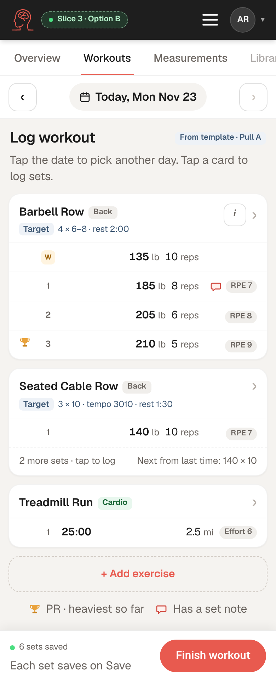
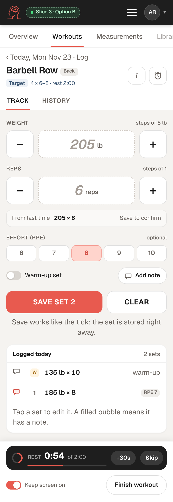
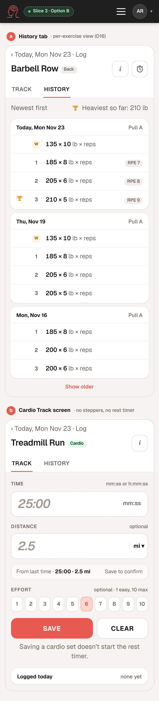

# Slice 3 — Workouts mockups

UI references for [`docs/vertical_slices/slice_3_workouts/`](../../vertical_slices/slice_3_workouts/README.md). Numbers, names, and any “Mockup” labels are **sample content**. Do not ship those hard-coded values.

Chrome (charcoal bar, coral welcome band, warm page, coral primary buttons) matches `docs/brand_style_guide.md`. Fitness Overview content remains [`../nov_2026_tickets/F-fitness-overview.png`](../nov_2026_tickets/F-fitness-overview.png) (OV.1).

## Option B (locked Nov 23, 2026)

These three phone frames (390 px wide, 2x) show the locked logging flow from the Slice 3 README. Where a frame and the README disagree, the README wins.

**`option-b-01-day-view.png`**: the D1 day view with ‹ Today › date arrows (the date stays editable), one card per exercise, the D11 trophy on the PR set row, a D8 per-set note icon, a D28 cardio card (Treadmill Run, time · distance · effort), **+ Add exercise**, and the D21 sticky bar with **Finish workout**.

**`option-b-02-track.png`**: the D1 Track screen for one exercise (Track and History tabs, D22 info button). It has D27 steppers (5 lb, reps by 1) in boxed inputs with the unit inside, the D24 "From last time" prefill, optional RPE chips, the warm-up toggle, the D8 per-set **Add note**, **Save set** (save on tick) and **Clear**, today's set list, and the D13/D25 rest timer in the sticky bar with +30s, Skip and **Keep screen on**.

**`option-b-03-history-and-cardio.png`**: (a) the D16 per-exercise History tab, with past sessions newest first and the D11 trophy on the heaviest set; (b) the D28 cardio Track screen, with boxed Time (mm:ss), Distance with an mi/km/m unit, optional Effort, D24 prefill, Save and Clear, and no steppers or rest timer.

**Mockup-only details, not built:**

- The green **"Slice 3 · Option B"** tag in the nav is a mockup label. The real nav has no such tag.
- The Seated Cable Row target line on `option-b-01-day-view.png` reads "tempo 3010". Tempo is **not** a field in Slice 3. It lives in the exercise note (D22), per the Slice 3 README. The real target line shows sets, reps and rest only.

The JPG images below are the pre-lock frames from 2026-11-23. Frames not covered by Option B still wait on a design pass. Do not edit the JPG files. The Slice 3 README wins over any image.

The locked log is **Option B**: a day view plus a per-exercise Track screen (D1, changed Nov 23, 2026), shown in the Option B frames above. The three JPGs below are kept for reference. **For the logging flow they are superseded by Option B**: `log-workout-desktop.jpg` shows the earlier inline layout. The Workouts tab and picker frames are still the pre-lock versions.

| File | What it is |
|------|------------|
| `workouts-tab-desktop.jpg` | Pre-lock Workouts tab: history list + this-week progress, welcome band **+ Log workout**. |
| `log-workout-desktop.jpg` | **Superseded for the logging flow by Option B.** Pre-lock log form: session name, date, duration, set tables, Save workout. No live session clock, which still matches D1. It does not yet show tick-to-save, the rest pill, the per-dumbbell hint, the notes info button, the PR badge, or the sticky save/finish bar. |
| `exercise-picker-desktop.jpg` | Pre-lock Add exercise modal: search, muscle chips, create custom. It does not yet show the fuzzy-duplicate warning or **Create anyway**. |

## How to read these

1. **Capture is Option B** (D1, changed Nov 23, 2026): day view, then Track at `?exercise=`. Save set still saves immediately. No live session or stopwatch. See the Option B frames above. The committed `log-workout-desktop.jpg` is the older inline form and is superseded for logging.
2. **+ Log workout** opens a new log for today. No start chooser (D15).
3. The Library tab stays coming soon. The picker search sheet is the only library UI. The per-exercise history view (past sets and the PR badge) is not a Library page (D16).
4. The Workouts tab mock may still show Overview as a tab; Overview content stays off until OV.1 with this slice.
5. Written README wins when it disagrees with a JPG.

## Still needed from the design pass

- Phone-width frame for the finish summary. (The log, Track and History are covered by Option B above.)
- Per-dumbbell hint, the duplicate warning with Create anyway, and the template-notes popover open. (The PR trophy, History view, rest pill and info button appear in Option B.)
- Template list / start-from-template frame when ticket 3.6 is specified.
- Empty-state Workouts tab frame (honest empty, no sample rows).
